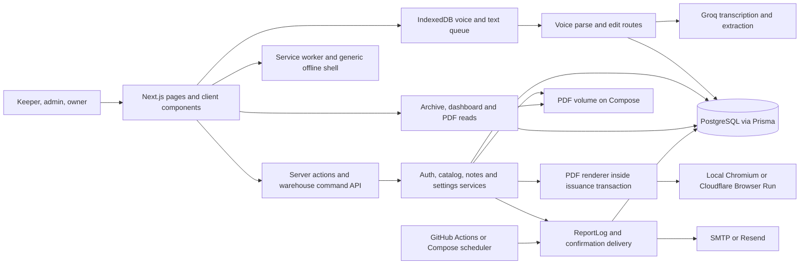
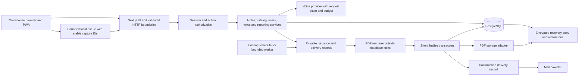

# Warehouse Issue Note Creator technical audit

**27 November 2026 · Baseline `002b21f` · Branch `deployment/free-cloud-no-card`**

The app replaces a WhatsApp-to-Word handoff with an Arabic-first workflow. The keeper records or types an order, reviews the customer and lines, and issues a numbered PDF for sharing. Administrators maintain the catalog and can correct issued notes. Owners also manage users and settings and receive reports. The product targets a note in under 60 seconds, at least 90% correct spoken-item matches after the first month, and no duplicate or missing automatically issued numbers. The plan describes a small initial catalog and gives no measured peak traffic or production data volume. This roadmap sizes changes for that workload and uses measurement to trigger further scaling. [Product plan](PLAN.md)

**Release assessment.** The existing architecture fits a single warehouse. Before a wider rollout, close username-only enrollment, prevent removal of the final active owner, make issuance recoverable across retries and provider failure, and establish a verified restore path. A controlled pilot should prove numbering, recovery, and the keeper workflow on the actual warehouse device before daily operations depend on it.

## Current architecture and data flow

| Workflow                | Current path and invariant                                                                                                                                                                                                                                                                                                                                                                                                      |
| ----------------------- | ------------------------------------------------------------------------------------------------------------------------------------------------------------------------------------------------------------------------------------------------------------------------------------------------------------------------------------------------------------------------------------------------------------------------------- |
| Sign-in and permissions | Login Server Actions validate username and PIN. PostgreSQL serializes sign-in for an account and stores a hash of a random session token. The `__Host-warehouse` cookie is secure, HTTP-only and SameSite Strict. Each request resolves the current role and active flag. The role map and per-note keeper scope provide separate authorization checks.                                                                         |
| Voice and offline       | Browser MediaRecorder supplies WebM or MP4, or the user types text. The server loads active catalog entries, calls Groq, validates structured output, resolves matches locally and stores the transcript and parsed draft. IndexedDB queues raw input and later the parse result. A matching signed-in session is required to upload a queued recording. The service worker caches the generic offline shell and static assets. |
| Draft and issue         | The typed editor autosaves. Voice review creates or updates a draft before a separate confirmation call. The server locks the draft and, for a new number, the counter. It renders the PDF, saves it to PostgreSQL or disk, marks the note confirmed and records audit and email job data. Reissues reuse the number and increase the version. Voiding preserves the record.                                                    |
| PDF and sharing         | The signed-in PDF route enforces note scope. A separate expiring link serves emailed PDFs. The client renders pages with PDF.js, offers native file sharing where supported, and provides print, open and download.                                                                                                                                                                                                             |
| Admin and owner         | Catalog changes write audit snapshots. The owner dashboard reads current issued-note rows and a separate latest-ten activity feed. Settings writes schedule, recipients, numbering start, company text fields and AI thresholds. The scheduler and confirmation path coordinate through `ReportLog`.                                                                                                                            |
| Deployment              | Compose runs Next.js, PostgreSQL, Caddy, the scheduler and filesystem backups. The cloud profile uses Netlify, Neon, Cloudflare Browser Run and GitHub Actions. The repository contains both profiles. The active production profile and its runtime settings were outside this review.                                                                                                                                         |

The App Router, Prisma service functions, Zod schemas and deterministic AI/PDF seams are sound foundations. Keep those. Pages can remain Server Components for initial reads and Client Components for interaction. Move dashboard and settings queries into the existing services so pages consume purpose-built view data. Replace browser imports of server-layer types and the Web Share adapter under `src/server/sharing` with shared contracts and a browser module. The graph query surfaced related modules and was checked against source. Static import-cycle verification is recorded under verification.

## Prioritized findings

P0 is a release gate where the condition applies. P1 protects daily operation or closes a product acceptance gap. P2 improves maintainability and growth after the pilot. For one engineer familiar with the repo, **S** means up to two days, **M** three to five days and **L** roughly one to two weeks. Estimates exclude business decisions, environment setup and pilot observation.

### Release gates

#### P0-01 Require verified account enrollment

Login can enroll an active user with a null PIN using only the username when `REQUIRE_PROVISIONED_PIN` is unset or false. The login screen reveals the enrollment state. Compose enforces provisioning. The cloud guide recommends seeding, but the seed creates predictable usernames with null PINs, including an owner. A production setup following that combination can leave privileged accounts open to unauthorized enrollment. [Auth](../src/server/auth.ts#L13) · [Login](../src/app/login/page.tsx#L12) · [Seed](../prisma/seed.ts) · [Cloud guide](FREE_CLOUD_DEPLOYMENT.md#4-create-the-netlify-site)

**Acceptance.** Fail closed in every production profile. Bootstrap owners through the existing CLI. For first sign-in, either use administrator-provisioned credentials or a short-lived, single-use invitation delivered through an approved channel. Add an environment gate for active privileged accounts lacking credentials. Verify existing users and newly provisioned users can still sign in.

**Effort and regression risk.** M. A stricter default can lock out legitimate uninitialized users. Inventory and provision before enforcing it.

#### P0-02 Protect the final active owner

User updates and archive operations lock the target and revoke sessions, but permit archiving or demoting the last owner. Bootstrap refuses when any owner row already exists, including an archived one. One settings mistake can remove all in-app recovery. [Catalog](../src/server/catalog.ts#L40) · [Owner bootstrap](../deploy/bootstrap-owner.ts#L16)

**Acceptance.** Serialize owner-set changes and require one active owner with usable credentials at commit. Add a verified, auditable emergency recovery procedure. Test a single-owner change, a credential reset, and simultaneous changes to separate owners.

**Effort and regression risk.** M. Preserve legitimate owner rotation and session revocation.

#### P0-03 Make confirmation recoverable

PDF rendering and storage run inside the database transaction holding the note and new-number counter locks. The renderer queue and remote request can outlast the HTTP budget. A committed request with a lost response looks like a conflict on retry. The filesystem path also has a crash window before commit. [Issuance](../src/server/notes/index.ts#L133) · [Counter](../src/server/counter.ts#L5) · [Renderer](../src/pdf/render-note-pdf.ts#L17) · [Chromium queue](../src/pdf/chromium.ts#L5)

**Acceptance.** Persist a stable issuance request and frozen render inputs. Render outside the transaction and publish the PDF and audit with a short final transaction. Preserve the current no-gap automatic numbering rule using compare-and-commit with rerender on a candidate conflict, or a durable ordered reservation policy approved by the owner. Keep draft, processing, issued and retryable states legible. Verify simultaneous typed and voice confirms, timeout after commit, renderer interruption, storage failure and amendment.

**Effort and regression risk.** L. Date rollover, manual overrides, existing reissues, historical PDF layout and numbering are sensitive. See design below.

#### P0-04 Prove backup restoration

Compose keeps database and PDFs in volumes on one host and backs both into another volume on that host. The cloud workflow archives a database dump as a short-retention GitHub artifact. Both approaches need independent evidence that a complete warehouse history can be recovered within a tolerable time. [Compose](../docker-compose.prod.yml) · [Backup script](../deploy/backup.sh) · [Cloud backup workflow](../.github/workflows/backup.yml)

**Acceptance.** Verify encrypted, off-host recovery copies and restrict restoration credentials. Add a checksum manifest, freshness alert and isolated restore drill. Compare row counts, number/version chains and PDF hashes before accepting the restore. Start with an owner-approved 24-hour recovery point and a four-hour recovery target.

**Effort and regression risk.** M. Test both storage layouts before changing retention or the restore runbook.

#### P0-05 Require a disposable test database

`tests/run-isolated.ts` falls back to `DATABASE_URL` and creates then force-drops a generated database. Its comment promises a local target, but the code does not verify an isolated endpoint. A developer with a privileged hosted URL can run DDL against the wrong cluster. [Test harness](../tests/run-isolated.ts)

**Acceptance.** Require explicit disposable test configuration, reject hosts and targets outside the test policy, and scope credentials to a dedicated test cluster. Keep CI service-container support explicit. Report cleanup failures separately from test failures.

**Effort and regression risk.** S. Update local and CI setup so adoption does not break routine test runs.

### Protect daily operation

#### P1-06 Strengthen credential and session policy

PINs are four to six digits, login attempts are keyed only by username, and the session lasts 30 days. Persistent limits protect individual accounts, but there is no policy for source-wide pressure, shared-device idle lock, or stronger owner authentication. Login-attempt and expired-session rows have no cleanup path. [Inputs](../src/lib/inputs.ts#L12) · [Auth](../src/server/auth.ts#L7) · [Session](../src/server/session.ts)

**Acceptance.** Combine per-account and trusted-source limits with bounded audit volume. Apply an idle limit and step-up for owner account, recipient or numbering changes, and evaluate owner passkeys or MFA. Keep a recoverable keeper flow. Verify on a shared warehouse device under a busy shift.

**Effort and regression risk.** M–L. Browser trust, recovery and shared-network throttling need pilot coverage.

#### P1-07 Review learned catalog aliases

Alias learning writes directly to the shared active catalog for any workspace role. A correction calls the endpoint before confirmation. The endpoint does not tie a proposed alias to a recording or detect cross-entry normalized collisions. A discarded or mistaken correction can affect future notes. [Alias handler](../src/app/api/voice/alias-handler.ts) · [Alias service](../src/server/voice-alias.ts) · [Review](../src/app/voice/review.tsx#L132)

**Acceptance.** Make learning a recorded suggestion tied to a verified correction or confirmed note. Put ambiguous aliases in the existing catalog review workflow and audit the decision. Preserve one-tap correction and keeper product creation. Track precision using accepted corrections and evaluated fixtures.

**Effort and regression risk.** M. Existing aliases may collide. Flag and reconcile, then enforce.

#### P1-08 Make offline replay safe and visible

Offline recordings and results persist in IndexedDB without expiration or limits. Login clears the keeper marker on that screen, while the offline shell uses the last marker available on the device. A lost online parse response can cause new work on replay. Removing a browser queue entry does not remove an already-saved server draft. [Draft store](../src/app/pwa/drafts.ts) · [Sync](../src/app/pwa/waiting-drafts.tsx) · [Worker registration](../src/app/pwa/register.tsx) · [Voice persistence](../src/server/voice.ts#L27)

**Acceptance.** Give every capture a stable request ID before first upload. Claim processing by account and request ID before provider calls. Set age and size bounds, expose retryable and terminal states, and provide a clear logout/shared-device policy that accounts for unsynced work. Keep the current session match and generic cache. Verify two tabs, logout, account switch, network flapping and quota exhaustion.

**Effort and regression risk.** L. Migrate pending entries without silently losing recordings.

#### P1-09 Preserve report delivery identity

The scheduler checks the latest due date per frequency, so intermediate unscheduled dates can be missed after downtime. `retryReport` strips the test marker and reuses the regular-period key. Reports use current recipients on retry, and the cron route returns `ok: true` even when individual reports fail. These paths can miss a report, obscure failure, or turn a failed test into a scheduled send. [Schedule](../src/server/reports/schedule.ts#L15) · [Delivery](../src/server/reports/delivery.ts#L91) · [Cron route](../src/app/api/cron/reports/route.ts)

**Acceptance.** Enumerate a bounded history of due periods, preserve the original delivery identity and an approved recipient policy, and add a digest/alert of failed or uncertain jobs. Keep ambiguous SMTP outcomes for reconciliation. Verify delayed invocation, multiple missed days, Cairo daylight saving, test/scheduled isolation and partial recipient rejection.

**Effort and regression risk.** M–L. Preserve existing deduplication and avoid replaying historical mail on rollout.

#### P1-10 Link and retain voice data deliberately

`Recording.noteId` exists but the voice UI drops `recordingId` when it sends note fields. The server retains transcripts and parsed JSON without a retention path. Online parsing sends active catalogs to Groq, and cloud rendering sends full note HTML to Cloudflare. Audio and note metadata cross different trust boundaries. [Recording schema](../prisma/schema.prisma#L102) · [Voice service](../src/server/voice.ts#L27) · [Review confirmation](../src/app/voice/review.tsx#L202) · [Renderer](../src/pdf/render-note-pdf.ts#L17)

**Acceptance.** Link an owned recording to the issued note transactionally with privacy-minimized provenance. Agree on retention by data type and processor. Purge abandoned transcripts, retain only what the business needs for disputes and accuracy, and keep provider errors and transcript text out of operational logs. Measure provider request size and duration.

**Effort and regression risk.** M. Existing transcripts may lack linkage. Treat them as legacy and avoid guessing provenance.

#### P1-11 Protect concurrent draft edits

Create, edit and confirm validate UUIDs and structure, but do not check whether catalog selections are still active. `expected` is optional for edit and confirm. The editor queues a periodic save even while a prior save is outstanding. A stale client can overwrite changes or issue using a catalog entry archived during review. Lost create responses can leave additional drafts. [Command schema](../src/app/api/warehouse/route.ts#L27) · [Notes service](../src/server/notes/index.ts#L48) · [Typed autosave](../src/app/notes/editor.tsx#L75)

**Acceptance.** Require a revision token on draft writes, coalesce autosaves to the latest snapshot, use a stable creation key and show recoverable conflict states. Agree on an active-catalog rule for new or changed lines and allow historical records to retain archived products. Verify two tabs, archive-during-review, and recovery after a response is lost.

**Effort and regression risk.** M. Reissues with historical inactive entries and older drafts need explicit behavior.

#### P1-12 Retain issued labels and historical dates

Issued rows reference live customer and product names. Reports select current names, while PDFs embed names at issuance. Reissuing stamps a fresh Cairo date and makes the earlier version disappear from current-only reports. A catalog rename or later correction can change historical dashboard results and export labels. [Issue rendering](../src/server/notes/index.ts#L150) · [Report query](../src/server/reports/index.ts#L4) · [Note detail](../src/app/notes/[id]/page.tsx)

**Acceptance.** Store issuance label/company snapshots alongside references and retain original issue date plus revision time. Define whether reports represent current corrected history or the activity in each period. Add links across the version chain. Test rename, void and amendment across a Cairo month boundary.

**Effort and regression risk.** L. Changes to previously reported totals require owner approval and a documented backfill. Existing PDF bytes are authoritative for their visible contents.

#### P1-13 Bound archive, dashboard and export work

Archive reads the full result set and creates an audit row on each read. Dashboard reloads reports and its activity query every 15 seconds when visible. Report ranges can span 3,660 days, rows are aggregated in memory, and Excel is built in memory. Catalog lists also fetch then filter in JavaScript. [Archive service](../src/server/notes/index.ts#L247) · [Feed refresh](../src/app/dashboard/charts.tsx#L14) · [Report ranges](../src/server/reports/period.ts#L14) · [Export](../src/server/reports/export.ts#L31) · [Catalog listing](../src/server/catalog-list.ts)

**Acceptance.** Add cursor pagination and a stable sort to archive and admin lists. Cap interactive report ranges and refresh the small feed separately. Measure query plans with synthetic records before adding targeted indexes or using SQL aggregates. Place larger exports behind a bounded job if production measurements warrant it.

**Effort and regression risk.** M–L. Verify filter parity, date presets, export totals and page boundaries.

#### P1-14 Control emailed PDF grants

The signed PDF route accepts a seven-day transferable link with no session or per-link revocation. Its response is private and has `no-referrer`, but a copied URL can still be redeemed during the validity window. The route does not record a redemption event or check void/superseded state. [Link signer](../src/server/reports/links.ts) · [Report PDF route](../src/app/api/reports/pdf/[id]/route.ts)

**Acceptance.** Decide whether links go to internal users only. Prefer authenticated downloads for staff. Where external recipients need links, use narrower expiry, revocable grants, redacted redemption logs and an explicit policy for voided or superseded versions. Preserve historical downloads for authorized staff.

**Effort and regression risk.** M. Existing emails need an expiry transition and recipient communication.

#### P1-15 Make deployment, migration and rollback predictable

The cloud deploy workflow applies migrations before successful application deployment. The guide also describes an automatic Netlify deploy path. Workflow and image tags are mutable in places. Cloud health verifies renderer credentials are present, while the test suite exercises local Chromium. A broken provider token or incompatible schema can pass parts of the release flow. [Deploy workflow](../.github/workflows/deploy.yml) · [Netlify config](../netlify.toml) · [Health route](../src/app/api/health/route.ts) · [CI](../.github/workflows/ci.yml)

**Acceptance.** Choose one controlled release path per environment, build before database changes, and use compatible expand-and-contract migrations. Pin build inputs, scope migration credentials separately, and verify authenticated staging readiness with synthetic PDF, audio and mail checks. Keep liveness cheap and distinguish it from dependency readiness.

**Effort and regression risk.** M. Verify adapter behavior and rollback against the previous application release before enforcing the gate.

### Improve maintainability and interaction quality

#### P2-16 Consolidate typed and voice editing contracts

The 532-line voice review and 476-line typed editor implement parallel line editing, product pickers, save and confirm orchestration. The browser command client accepts an untyped payload and returns unvalidated JSON. Error handling repeats across forms. [Voice review](../src/app/voice/review.tsx) · [Typed editor](../src/app/notes/editor.tsx) · [Command client](../src/app/notes/command.ts)

**Acceptance.** First pin current behavior with focused tests. Share typed commands and response parsing, business quantity limits, product search, issue-state messages and line controls where behavior matches. Extract small feature-specific pieces for voice correction and manual autosave. Keep one note command endpoint while its domain dispatch stays small.

**Effort and regression risk.** M. Protect focus, voice undo, remarks and number override behavior during extraction.

#### P2-17 Clarify service and browser boundaries

`catalog.ts` repeats transactional read/lock/change/audit patterns and mixes user credential changes with products and customers. Dashboard and settings bypass the service boundary for reads. The generic HTTP helper imports a voice-specific body utility. The WhatsApp Business sender is a placeholder with no production caller. [Catalog](../src/server/catalog.ts) · [HTTP helper](../src/server/http.ts) · [Dashboard](../src/app/dashboard/page.tsx) · [Settings](../src/app/settings/page.tsx) · [WhatsApp placeholder](../src/server/sharing/whatsapp.ts)

**Acceptance.** Isolate user administration, move shared request limits to the HTTP boundary and keep domain queries close to their services. Move `@types/nodemailer` to dev dependencies after verifying production builds. Remove unused stubs/assets only after call-site, docs and generated-output checks. Preserve the working manual share path.

**Effort and regression risk.** S–M. Verify Docker runtime dependency tracing, seed/bootstrap and all authorized catalog actions.

#### P2-18 Make verification reproducible

The original QA document records incomplete mobile/desktop runs, CI runs Chromium only, and axe coverage is selective. TypeScript's broad include picks up ignored local diagnostic configs. Several source strings, date formats and CSS breakpoints are inconsistent across flows. [QA report](QA-REPORT.md) · [TypeScript config](../tsconfig.json) · [Playwright config](../playwright.config.ts) · [Root layout](../src/app/layout.tsx) · [Styles](../src/app/globals.css)

**Acceptance.** Exclude generated QA output from typechecking. Add a browser and viewport matrix focused on critical workflows, and extract localized formatters and semantic tokens based on the page findings below. Record release evidence per revision with fixtures, environment and actual exit results.

**Effort and regression risk.** M. Validate local clean checkout, existing CI and production standalone packaging.

## Proposed architecture

1. Have confirmation return the result for a stable request key. The server validates ownership, the draft revision, active catalog policy and requested number. Freeze template data and record a durable processing claim. Retain the ability to complete in the same HTTP request within a small deadline and resume through the existing scheduler if needed.
2. Prototype optimistic number allocation for the expected small workload. Render with a candidate number outside the lock, then take the short counter and note locks. Finalize only if the candidate, draft revision and state still match. On a normal counter collision, rerender against the next candidate. A manually chosen number returns a clear conflict. At higher contention, compare a single durable issuance worker that processes ordered requests and defers final allocation until success. Prove the no-gap automatic numbering invariant before selecting either approach.
3. For PostgreSQL PDF bytes, publish with the note row in one transaction. For filesystem storage, stage immutable bytes, verify them before commit, and reconcile unreferenced temporary files after crashes. Persist a byte count and content hash. Keep the existing document ID and version URL so old PDFs remain reachable.
4. Keep `ReportLog` while its scope is small, but use typed state transitions and stable delivery identities. Persist the intended mail job when issuing the note. Add provider receipt IDs where available. Run a small, bounded batch per scheduler invocation with observable outcomes. PostgreSQL remains the source of truth for job state.
5. Use stable cursor queries, select only view fields and time the hottest requests before moving aggregation to SQL. Add request-level deduplication for repeated session resolution. Set an explicit pool size and timeout per deployment profile. Pilot with the current framework and one application process or function deployment. Consider a dedicated worker or object storage when measured retry volume, PDF bytes, or backup time justify it.

### Coding standards for the refactor

- Use strict shared Zod contracts at request and provider boundaries, plus small typed command responses. Keep authorization and domain validation in the service even when the client hides the control. Return stable application error codes, Arabic messages and a request ID for unexpected failures.
- Give every retryable mutation an explicit idempotency or revision rule. Keep remote work out of DB locks and propagate cancellation when bounded work can be interrupted. Share request budgets and date, quantity and Arabic digit formatters through existing modules.
- Split components where state has a different lifecycle. Keep capture, line editing, draft persistence and issuance status independently testable. Profile re-renders during the 100 ms recorder meter updates and on large forms before adding memoization. PDF preview should render visible pages progressively and release its worker and canvases on navigation.
- Keep direct Prisma usage in domain services. Add a repository abstraction only when a concrete persistence seam needs it, as PDF storage already does. Remove proven dead code after tracing static, dynamic, script and documentation usage. Preserve the existing deterministic test provider with test-only configuration.

### Data integrity and migrations

- PostgreSQL already enforces FK references, unique note number/version and predecessor, unique line position, positive quantities and counter invariants. Preserve the handwritten SQL constraints during schema changes. P0-03 and P1-12 should make issuance metadata explicit. Add a single current-version invariant if query plans and the chosen versioning design warrant it. Validate orphan, counter and version-chain counts before and after migration. [Schema](../prisma/schema.prisma) · [Initial SQL](../prisma/migrations/202611210001_foundation/migration.sql) · [Version migration](../prisma/migrations/202611210003_note_versions/migration.sql)
- Test candidate indexes against real query shapes using seeded synthetic data. Start with `IssueNote(createdById, createdAt, id)` for keeper history, date/status for reports, `NoteLine(productId, noteId)` for the archive filter, and expiry/time indexes when implementing session and audit retention. Indexed normalized text or trigram search becomes useful only after catalog and archive queries warrant it.
- Add a migration check on both a blank database and a restored, sanitized pre-upgrade fixture. Include existing filesystem PDFs, database PDFs, archived catalog references, superseded versions and settings JSON. Upgrade the old release during a restore rehearsal before relying on application rollback. Use paged PDF migration, resumable upsert and checksum verification before changing the storage driver. [PDF migration script](../scripts/migrate-pdfs.ts)
- Define retention and access for recordings, audit snapshots, sessions, rate-limit records, report jobs and backups. Audit snapshots redact PIN and token hashes, but can still contain note lines and settings. Keep forensic events for privilege changes, issuance, voids, manual number override and signed-link redemption as policy allows. Turn high-volume archive reads into bounded telemetry where audit policy permits. [Audit helper](../src/server/audit.ts) · [Archive query](../src/server/notes/index.ts#L247)

## UI and workflow review

The app has a coherent starting point. It uses the Italin wordmark, Cairo, neutral surfaces and state colors. The main issues are inconsistent feedback and density across screens, a separate interaction model for voice and typed entry, and narrow layouts that put frequent actions behind long forms. Source review covers every page family and shared component group. The saved green, yellow and red review images are historical design evidence. Runtime verification is listed below.

| Screen or workflow              | Current behavior and change                                                                                                                                                                                                                                                                                                                                                                                                                                                                                                                                                                             |
| ------------------------------- | ------------------------------------------------------------------------------------------------------------------------------------------------------------------------------------------------------------------------------------------------------------------------------------------------------------------------------------------------------------------------------------------------------------------------------------------------------------------------------------------------------------------------------------------------------------------------------------------------------- |
| Public home and login           | The landing page leads to sign-in. The sign-in panel uses brand artwork on desktop and hides the image on mobile. Username and PIN take two steps. Consolidate regular sign-in into one form, preserve password-manager autocomplete and paste, and move verified enrollment into its own flow. Keep generic credential failure, add field-specific format errors and focus the failing input. [Home](../src/app/page.tsx) · [Login](../src/app/login/page.tsx)                                                                                                                                         |
| Signed-in navigation            | Desktop sidebar and mobile `details` share links and role-aware visibility. Exact pathname matching leaves deep note pages without an active parent. Add a skip link, a stable current-section indicator and deliberate focus restoration after mobile menu navigation. Name each navigation landmark and prevent the mobile menu from obscuring keyboard focus. [Navigation](../src/app/brand/navigation.tsx) · [Workspace layout](../src/app/brand/workspace-layout.tsx)                                                                                                                              |
| Keeper workspace                | The microphone, manual note, two modes of reuse, recent notes and waiting drafts compete for space. Lead with recording and put manual entry beside it as the fallback. Surface the latest resumable draft and sync count before recent issued notes. Say which customer or note will be duplicated. Keep the frequent-customer shortcuts. [Workspace](../src/app/workspace/page.tsx)                                                                                                                                                                                                                   |
| Voice capture, help and offline | It already supports pause, resume, a meter and typing fallback. Distinguish microphone permission, provider delay, quota and local storage failure, and provide a retry with the same capture when possible. Preserve text and actionable recording feedback when the server is reachable but the provider fails. Make first-use help dismissible and reopenable, and show queued, syncing, editable, failed and local-only states. [Recorder](../src/app/voice/recorder.tsx) · [Help](../src/app/voice/help.tsx) · [Offline](../src/app/offline/page.tsx) · [Queue](../src/app/pwa/waiting-drafts.tsx) |
| Voice review and picker dialogs | The preview, editable cards, transcript, correction controls and sticky confirm bar cover the core work. Bring unmatched and uncertain lines into a summary with jump links. Preserve manual edits and undo. Focus the heading or first actionable problem on review, focus a usable control when the dialog opens, return focus to its trigger or next line, and make undo available for a predictable duration. Keep labels and status text alongside color. [Voice review](../src/app/voice/review.tsx) · [Line card](../src/app/voice/line-card.tsx)                                                |
| Typed draft and amendment       | The typed editor supports search, add, replace, reorder, remarks, autosave and summary. Show persistent save state near the title and communicate revision conflicts without clearing edits. Use the same field validation, quantity limits, product chooser and confirmation summary as voice. Preserve the separate amendment reason. Support recovered drafts and clearly label the record version. [Editor](../src/app/notes/editor.tsx)                                                                                                                                                            |
| Custom number                   | The native dialog has a warning and validation. Keep explicit opt-in and typeable Arabic digits. Show the reason for a conflict next to the number, preserve the draft and return focus to the field. Keep manual number assignment auditable. [Number control](../src/app/notes/number-control.tsx)                                                                                                                                                                                                                                                                                                    |
| Issued detail, void and PDF     | The document opens in a canvas preview with share, print, download and open. Add a semantic HTML summary and item table that remains available when PDF rendering fails or is inaccessible. Show document version history and issue date. Keep the void reason and add an explicit final confirmation naming the number and effect. Render large PDFs progressively and retain the download and print alternatives. [Detail](../src/app/notes/[id]/page.tsx) · [PDF preview](../src/app/notes/pdf-preview.tsx) · [Void form](../src/app/notes/void-form.tsx)                                            |
| Archive                         | Number/customer text, date, product and status filters already exist. Add an explicit customer filter, applied filter chips or summary, clear-all, deterministic sort, count and pagination. Differentiate invalid filters, no matches and a truly empty archive. Use compact rows on desktop and stacked metadata cards on narrow screens. Preserve filter state when returning from a note. [Archive](../src/app/archive/page.tsx) · [Rows](../src/app/notes/note-list.tsx)                                                                                                                           |
| Products, customers and users   | Catalogs have search, inline forms and archived/review labels. Add active, archived and needs-review filters, display duplicate candidates before keeper product creation, and show context and a confirm step before archive, user deactivation or role change. Show user provisioning status without revealing credentials. Resolve whether admins should have a user-management screen or whether the API should be owner-only. [Catalog pages](../src/app/admin/[section]/page.tsx) · [New product](../src/app/products/new/page.tsx) · [Forms](../src/app/catalog-forms.tsx)                       |
| Owner dashboard                 | Today/week/month shortcuts, comparisons, charts, export and feed are present. Distinguish the chosen report period from the current activity feed. Announce feed freshness without rereading rows to assistive technology. Use compact KPI cards, labelled chart data tables, visible units and short date labels. Keep large exports and long ranges off the interactive path. [Dashboard](../src/app/dashboard/page.tsx) · [Charts](../src/app/dashboard/charts.tsx)                                                                                                                                  |
| Owner settings                  | The long page uses a single shared busy state and sticky feedback. Give sections local status and field errors, show Cairo time and the next scheduled send, and state whether the test uses saved recipients. Isolate test jobs from real periods and give the owner clear treatment for failed and uncertain deliveries. Add confirmation for access, recipient and numbering changes. [Settings page](../src/app/settings/page.tsx) · [Form](../src/app/settings/settings-form.tsx)                                                                                                                  |
| Loading, empty and failure      | The app has route loading, pending links, error boundaries and a 404. Align the Arabic tone and distinguish network failure, stale revision, invalid fields, provider failure and access denial. Keep retries near the failed action, retain entered data and provide a request reference for server errors. [Loading](../src/app/loading.tsx) · [Error](../src/app/error.tsx) · [Global error](../src/app/global-error.tsx) · [404](../src/app/not-found.tsx)                                                                                                                                          |

### Design system and responsive rules

| Foundation               | Proposed standard                                                                                                                                                                                                                                                                                                                                                                                                                                                                                                                  |
| ------------------------ | ---------------------------------------------------------------------------------------------------------------------------------------------------------------------------------------------------------------------------------------------------------------------------------------------------------------------------------------------------------------------------------------------------------------------------------------------------------------------------------------------------------------------------------- |
| Color and contrast       | Retain paper `#f8f7f5`, surface `#fff`, ink `#171717`, muted `#5d5b57` and graphite `#242424` for primary actions. Use existing review colors `#226144`, `#835800`, `#9e282b` for success, attention and blocking status, paired with icon and text. Keep `#d7d5d0` for decorative separators and use a darker semantic outline such as `#75644d` when the border is the only cue identifying a control. Check text at 4.5:1 for normal text and 3:1 for large text and meaningful component boundaries.                           |
| Type                     | Use self-hosted Cairo at 16/26 px for body, 14/22 px for metadata, 20/30 px for section titles and 28/40 px for page titles. Use weights 400, 600 and 700, tabular numerals for quantities and note numbers, and `bdi` or explicit direction where mixed-script text needs isolation.                                                                                                                                                                                                                                              |
| Spacing and shape        | Base layout on 4, 8, 12, 16, 24, 32 and 48 px. Use quiet borders, small radii on controls and slightly larger radii for cards and dialogs. Reserve shadow for overlays. Keep a 48 × 48 px minimum for the product's interactive controls, including menu, icon buttons and the whole clickable checkbox row.                                                                                                                                                                                                                       |
| Component variants       | Define primary, secondary, text and danger buttons with focus, disabled and pending states. Give fields labels, hints, field errors and invalid state. Standardize status pill, card, filter, dialog, empty state, notification and table patterns. Prefer one primary task per task panel.                                                                                                                                                                                                                                        |
| Navigation and reflow    | Start with one column at 320–639 px and a top menu. From 640–1023 px, keep a top menu and use two columns only where content fits. At 1024 px and above, show the sidebar and allow wider report grids. Verify 320, 390, 768, 1024, 1280 and 1440 px, and 200% zoom. Use logical CSS properties and allow long Arabic/English labels to wrap. Only intrinsically tabular data should require a horizontal scrolling region.                                                                                                        |
| Interaction and feedback | Use calm `role=status` announcements for save, queue and processing and alerts for blocking errors. Keep keyboard focus visible and out of sticky regions. Put a descriptive confirmation and reason on irreversible business actions. Show the successful outcome in context. Keep the current light scheme as the supported baseline until a dark palette has its own tests.                                                                                                                                                     |
| Localization             | The app has `lang=ar-EG`, document RTL and mixed-script product data. It has no English locale selector. Centralize scattered strings in `src/lib/i18n.ts` and date/quantity formatting in shared Cairo-aware formatters. Keep ISO values at request and DB boundaries, decide numeral style in the UI and preserve the approved PDF format. If an English locale is required, add message parity, `lang=en`/`dir=ltr` and bidirectional visual tests. Currency formatting applies only if reporting later includes monetary data. |

Against white, the current ink measures 17.93:1, muted text 6.78:1, review state colors 6.25:1 to 7.52:1, and the shared border 1.47:1. Input borders that use this color need a stronger visual cue where the border identifies the control. The historical screenshots show the review toolbar crowding the sticky footer, while the current source also has sticky feedback in settings. Both deserve keyboard and zoom checks. [Current styles](../src/app/globals.css) · [Saved voice review](screenshots/voice-review/review-yellow.png)

The desktop login declares the 1.7 MB PNG as an unoptimized image. Measure transfer and rendering on a cold load, serve a smaller responsive variant, and preserve the current crop and contrast. Verify in browser network tools that the hidden artwork does not load unnecessarily on mobile. Keep the PDF logo, fonts and QR assets under the golden comparison rules. [Login](../src/app/login/page.tsx) · [Template specification](TEMPLATE-SPEC.md)

Review WCAG 2.2 AA for keyboard and focus order (2.1.1, 2.4.3, 2.4.7, 2.4.11), contrast and reflow (1.4.3, 1.4.10, 1.4.11), target size (2.5.8), errors and authentication (3.3.1–3.3.3, 3.3.8), and accessible names and statuses (4.1.2, 4.1.3). The product's 48 px target is stricter than the AA size criterion. Test the sticky confirm bar and settings output at zoom, screen-reader field labels after line reordering, menu and dialog focus, and the canvas alternative. Test VoiceOver/Safari, TalkBack/Chrome and NVDA/Chrome with mixed Arabic/Latin product labels. [W3C WCAG 2.2](https://www.w3.org/TR/WCAG22/)

## Defensive security review

The browser, application, database, report recipients, deployment operators, and AI, rendering and mail providers are distinct trust boundaries. The sensitive records are credentials and sessions, catalog data, customer names and remarks, recordings and transcripts, issued PDFs, audit logs and backups. Use OWASP Top 10 2025 to organize risk and ASVS 5.0 Level 2 as the proposed verification target for business data. The review does not establish ASVS conformance. [OWASP Top 10](https://top10.owasp.org/) · [OWASP ASVS](https://asvs.owasp.org/)

Start a release evidence matrix with V13.3.2 for access to secrets, V14.2.4 for protections by data type, and V16.3–V16.5 for security events, log protection and error handling. Record the control owner and a test for each applicable requirement. The application uses password-equivalent PINs and an opaque server session. Its microphone capture uses MediaRecorder and HTTP upload, so document the applicability of OAuth/OIDC and WebRTC requirements separately. [ASVS 5.0.0 requirements](https://github.com/OWASP/ASVS/blob/master/5.0/docs_en/OWASP_Application_Security_Verification_Standard_5.0.0_en.json)

| OWASP topic and related ASVS area                                            | Existing controls, review outcome and verification needed                                                                                                                                                                                                                                                                                                                                                                                                                                                                                                                                    |
| ---------------------------------------------------------------------------- | -------------------------------------------------------------------------------------------------------------------------------------------------------------------------------------------------------------------------------------------------------------------------------------------------------------------------------------------------------------------------------------------------------------------------------------------------------------------------------------------------------------------------------------------------------------------------------------------- |
| A01 access control · Authorization and API                                   | Session lookup uses current role and active state. Keeper detail, archive and signed-in PDF reads use creator scope. Admin user API hides owners and the service blocks changes to owner targets. The admin cannot open the corresponding users UI. Alias changes use broader workspace permission. Verify each role/action and object scope against the approved matrix, including privileged credential changes, return fields and P1-07/P1-14. [Permissions](../src/server/permissions.ts) · [Notes scope](../src/server/notes/index.ts#L36) · [Users API](../src/app/api/users/route.ts) |
| A02 configuration · Web frontend, API and configuration                      | Proxy adds nonce-based CSP and no-store for API responses. Server config adds security headers. The CSRF check derives expected origin from forwarded headers before host, so verify both deployment edges overwrite or reject untrusted forwarded values and configure explicit trusted origins. Verify signed-in HTML and Next.js data responses at the hosting edge. Separate local HTTP from HTTPS-only deployment config. [Proxy](../src/proxy.ts) · [Origin helper](../src/server/request-origin.ts) · [Next config](../next.config.ts)                                                |
| A03 supply chain · Secure build and deployment                               | The package manager and lockfile are pinned, and CI installs frozen and runs a production advisory scan. Tags, the cloud CLI fetched via `@latest`, and the automatic adapter can change. Generate an SBOM for release artifacts and check the browser and container OS as well as Node packages. Review privileged workflows and set explicit versions or immutable digests where practical. [CI](../.github/workflows/ci.yml) · [Deploy](../.github/workflows/deploy.yml) · [Dockerfile](../Dockerfile)                                                                                    |
| A04 cryptographic failures · Cryptography, communication and data protection | PINs use Argon2id and session tokens are random and hashed at rest. HMAC PDF grants use a shared secret with timing-safe checks. Require TLS for remote PostgreSQL and SMTP, and verify SMTP requires STARTTLS when using authenticated non-465 delivery. Give PDF signing a scoped key and rotation plan. Check backups for encryption and limited artifact access. [Auth](../src/server/auth.ts) · [Links](../src/server/reports/links.ts) · [Mail transport](../src/server/reports/mailer.ts)                                                                                             |
| A05 injection · Validation, encoding and sanitization                        | Zod bounds request shapes and input sizes. Raw application queries use tagged templates with values passed as parameters. React, the PDF template, and report email escape their relevant text paths. CSV quotes fields and neutralizes common formula prefixes. Verify mixed-script and long strings through HTML, PDF, recipient fields and exports. Move generic bounded parsing to the HTTP layer. [HTTP boundary](../src/server/http.ts) · [PDF template](../src/pdf/note-template.ts) · [Email](../src/server/reports/email.ts) · [Export](../src/server/reports/export.ts)            |
| A06 insecure design · Business logic and architecture                        | Issuance, numbering and one-successor semantics protect the business record. Risks remain in expensive work under a lock, draft replay, direct alias promotion, and the distinction between current and historical report totals. Threat-model these flows and use the invariants from P0-03, P1-07–P1-12 as acceptance criteria.                                                                                                                                                                                                                                                            |
| A07 authentication · Authentication and session management                   | P0-01, P0-02 and P1-06 cover enrollment, last-owner recovery, rate limits and session duration. Verify cookie expiry, sign-out, session revocation for resets/role changes and audit behavior. Test the operator recovery path with synthetic accounts before enforcing stronger privileged authentication. [Login actions](../src/app/login/actions.ts) · [Session](../src/server/session.ts)                                                                                                                                                                                               |
| A08 integrity · Data protection and file handling                            | Provider results are schema-checked and matched against active catalogs, and the keeper reviews before confirmation. Versioned PDFs are stored but carry no persisted content hash. Storage reads trust a database filesystem path. In filesystem mode, resolve within the configured PDF root and verify portable storage keys, with a compatibility path for historical absolute paths. Add provider response and PDF size limits where applicable and verify restored bytes. [AI pipeline](../src/ai/pipeline.ts) · [PDF storage](../src/server/pdf-storage.ts)                           |
| A09 logging and alerting · Security logging                                  | The API wrapper emits request ID, method, duration and status. Transactions record key business operations and redact credential hashes from snapshots. There is no owner audit screen or configured alerting in the repo. Add bounded operational queries and alert on authorization/error spikes, backup age, scheduler lag, repeated provider rejects and pending issuance age. Keep signed URL query tokens and transcripts out of access and application logs. [API logging](../src/server/http.ts) · [Audit](../src/server/audit.ts) · [Log config](../src/server/log.ts)              |
| A10 exceptional conditions · Error handling and availability                 | The app has fallback typing, error boundaries, request limits, provider deadlines and ambiguous-mail state. Voice spend limits use an in-memory map shared only by a single process, and a runtime fake AI setting is accepted without a production gate. Make quotas shared and bounded, classify retriable failures, forbid fake providers in production profiles, align upstream and client deadlines, and test provider interruption in staging. [Voice service](../src/server/voice.ts) · [Voice routes](../src/app/api/voice) · [Report delivery](../src/server/reports/delivery.ts)   |

### API and role coverage

| Surface                                                | Current gate and recommended release test                                                                                                                                                           |
| ------------------------------------------------------ | --------------------------------------------------------------------------------------------------------------------------------------------------------------------------------------------------- |
| Login, sign-out and workspace duplicate Server Actions | Origin checking and server-side validation, followed by role checks where applicable. Verify enrollment, login failure, session rotation/revocation, and keeper duplicate scope.                    |
| `POST /api/warehouse`                                  | Authenticated workspace plus action-specific service checks. Exercise every discriminated command for each role and every relevant ownership/status branch. Verify field limits and stable retries. |
| `GET /api/users`                                       | User-management privilege, with owners excluded from admin results. Verify payload omits credentials and decide whether admin management should be exposed in UI.                                   |
| `POST /api/voice/parse` and `/api/voice/edit`          | Workspace and note-create privileges respectively. Verify content and size policy on both, provider failure and timeout, and queued capture ownership.                                              |
| Product and customer `POST .../[id]/aliases`           | Workspace access plus active target. Verify that confirmed corrections preserve the allowed keeper flow and direct catalog mutations follow the chosen policy.                                      |
| `GET /api/notes/[id]/pdf`                              | Session and note scope. Verify owner/admin access, keeper own-note access and denial for another keeper's note.                                                                                     |
| `GET /api/reports/pdf/[id]`                            | Expiring signature. Verify token expiry, intended version, audit redaction, and revocation if introduced.                                                                                           |
| `GET /api/reports/export`                              | Owner only, validated range and format. Verify CSV/XLSX data and formula-safe values.                                                                                                               |
| `GET /api/health`, `GET/POST /api/cron/reports`        | Distinct bearer credentials. Verify that credentials do not cross roles, and check readiness or scheduler failure outcomes on each supported staging profile.                                       |

## Product acceptance and delivery plan

| Phase                                      | Work, dependencies and exit criteria                                                                                                                                                                                                                                                                                    |
| ------------------------------------------ | ----------------------------------------------------------------------------------------------------------------------------------------------------------------------------------------------------------------------------------------------------------------------------------------------------------------------- |
| 0. Protect the release                     | P0-01, P0-02 and P0-05 in separate changes. Start restore drill P0-04 and measure current confirmation latency for P0-03 in parallel. Exit with protected enrollment, active-owner protection, a test-cluster guard and evidence that the previous release is recoverable.                                              |
| 1. Make issue and sync recoverable         | P0-03, P1-08, P1-10 and P1-11. Agree on numbering and catalog policy first. Exit with stable successful responses across retries, no silent draft loss in tested failures, preserved versions and correct PDF bytes. Test simultaneous confirmations, provider interruption and restart while a request is in progress. |
| 2. Harden reporting and operations         | P1-06, P1-07, P1-09, P1-12, P1-14, P1-15. Set recipient, history and privacy policies. Exit with an exercised restore and migration, accurate reports across Cairo calendar changes, per-job reconciliation, and staged proof from the real browser/rendering/mail providers.                                           |
| 3. Improve daily usability and scale reads | P1-13 and P2-16–18. Prioritize keeper workflow and WCAG before owner/admin refinements. Exit with paged archive, predictable mobile interactions, documented keyboard/screen-reader checks and a measured query/response budget on the approved catalog size.                                                           |

### Requirements that need a product decision

- [Product plan](PLAN.md) expects admin user management, owner audit visibility, configurable PDF details and numbering prefix, anomaly alerts and customer statements. Current UI keeps users owner-only, settings exposes company text and a number start, and the repo has no dedicated audit, anomaly or statement screen. Decide which items gate rollout. Preserve manual WhatsApp sharing and the absence of stock tracking.
- The plan describes daily email at 20:00 by default. The implementation uses 22:00 with reports disabled by default. Confirm that preset before updating guides or forcing changes to existing settings. Define quality rules for weekly/monthly trends and whether a report represents immutable past output or latest corrected state. [Report configuration](../src/lib/report-config.ts)
- Monthly schedules allow day 29, 30 and 31 even when the month lacks the chosen day. Agree whether to clamp to the final day or require days 1–28 so every month has a delivery. Document the policy in Settings and cover short months and leap years. [Schedule schema](../src/lib/report-config.ts) · [Calendar calculation](../src/server/reports/period.ts#L46)
- Choose one supported production profile for the first pilot. For cloud, bench actual audio request sizes and confirmation duration through the deployed adapter. Cloudflare documents separate Free-plan limits for Quick Actions and browser sessions. The application uses the PDF Quick Action. Validate quota and backoff for it explicitly. For Compose, verify volume ownership, independent backups and the same PDF output. [Cloudflare limits](https://developers.cloudflare.com/browser-run/limits/) · [Netlify functions configuration](https://docs.netlify.com/build/functions/configuration/) · [Neon connection pooling](https://neon.com/docs/connect/connection-pooling)

### QA and operational acceptance

| Gate                         | Release evidence                                                                                                                                                                                                                                                                                                                   |
| ---------------------------- | ---------------------------------------------------------------------------------------------------------------------------------------------------------------------------------------------------------------------------------------------------------------------------------------------------------------------------------- |
| Business flow                | Keeper pilot times sign-in/open to issued PDF across voice and typing, including corrections and offline reconnect. Record median and 90th percentile against the 60-second target. Use reviewed item-level Egyptian Arabic measurements for the 90% goal. Keep the fixture-provider score distinct from live speech accuracy.     |
| Data integrity               | Compare number/version sequences before and after concurrent issue, rollback, duplicate requests, reissue and void. Include Cairo midnight and manual overrides. Verify that loss of the HTTP response still lets the keeper recover the issued note.                                                                              |
| PDF output                   | Keep the reference images and approved fixtures immutable. Require single-page and multipage golden comparison, image/font packaging in both deployment environments, actual print/download on warehouse devices, and restoration by hash. Include longest supported product names, remarks, and the maximum realistic line count. |
| Responsive and accessibility | Run both Chromium profiles plus WebKit and a real iPhone/Android pass. Add 320 px, tablet portrait, laptop and zoom runs. Test bilingual data, browser permissions, focus after dialogs, field errors, keyboard menu, reduced motion and offline storage quotas. Record which tests used real hardware and assistive technology.   |
| Availability and performance | Log spans for auth, DB wait, voice, render and delivery. Test synthetic concurrency, a cold database, renderer rate limiting and partial mail rejection. Observe PDF throughput, database pool saturation, report delay and time to investigate security alerts.                                                                   |
| Production operations        | Record the deployment runtime versions, credentials' scopes and tested rollback. Monitor backup age and restore duration, scheduled delivery lag, confirmation failure/retry rate, voice quota and PDF queue age. Schedule and retain restore evidence according to the recovery objectives the owner approves.                    |

## Verification and limits

| Check                             | Result                                                                                                                                                                                                                                                                                                                                                                                    |
| --------------------------------- | ----------------------------------------------------------------------------------------------------------------------------------------------------------------------------------------------------------------------------------------------------------------------------------------------------------------------------------------------------------------------------------------- |
| Repository and architecture       | Inventoried tracked source, configuration, deploy and maintenance scripts, migrations, tests, dependencies, assets and reference files. Reviewed Graphify's existing graph alongside source. A static pass over 118 tracked TypeScript modules found 354 internal value-import edges and no cycles in that set. Dynamic imports and generated dependencies were outside this cycle check. |
| Lint and typechecking             | `pnpm lint` passed. The direct `pnpm typecheck` run failed on an ignored pre-existing diagnostics file under `tests/output/`. Route type generation succeeded, a compiler run excluding that diagnostic output passed, and the standard command passed in the clean tracked snapshot.                                                                                                     |
| Schema and unit/integration tests | Prisma schema validation and all eight migrations passed on disposable local PostgreSQL. All 112 Vitest tests passed after using the provider settings expected by the mocks. The suite includes concurrent numbering and issuance checks, PDF storage and golden comparisons, reports, auth and voice fixtures.                                                                          |
| Browser and production build      | The original checkout's mobile and desktop runners hit the existing Next.js development lock. Both isolated Chromium runs then timed out waiting for the server to start before any browser tests ran. The isolated production build was stopped after more than seven minutes in compilation. These runs did not establish a passing browser or build baseline.                          |
| Dependency advisories             | `pnpm audit --prod --json` returned no advisories for the locked production dependency graph. Container OS packages, the real deployment runtime and a full supply-chain attestation remain separate checks.                                                                                                                                                                              |

No production services or credentials were used for the checks. Actual WhatsApp sharing on warehouse phones, live Egyptian Arabic speech accuracy, real provider and mail delivery, deployment-edge behavior, restored production-format backups and manual WCAG/assistive-technology testing remain release evidence to collect. Existing generated files, historical QA output and reference assets were kept outside the documentation change.
